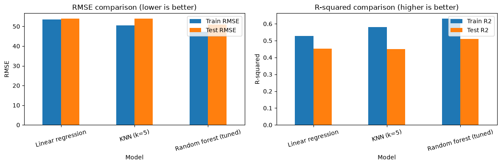

# What I Learned Through These Projects

## Start with a fair baseline

I first compared linear regression, KNN, and random forest on the diabetes benchmark. The tuned random forest reached test R² **0.510**, ahead of linear regression (**0.453**) and KNN (**0.450**). That taught me to compare models on held-out data instead of choosing one because it sounds more advanced.

## Learn from mistakes in model setup

The concrete work made the same lesson more obvious. A default Gaussian process had test R² **-49.990**, even though its training fit looked strong. Comparing kernels and then using Bayesian optimisation gave a much more useful result. I learned that train/test gaps are evidence, not something to hide.

## Move from prediction to constrained search

In the alloy work, I connected models to a search loop. I learned to check feature order, use held-out metrics, and enforce Fe–Co–Ni constraints before evaluating a proposed composition. A search answer is only useful when its inputs are valid.

## Work with images and generated samples

The segmentation and VAE projects taught me to inspect outputs visually. For segmentation, I checked masks and contours after each operation. For VAEs, I looked at both loss curves and generated samples. A plot can show progress; the image itself shows what the model still gets wrong.

## Apply the same habits to materials and automation

The materials work combined data access, feature generation, model checking, and molecular descriptors. The lab protocol work applied a different kind of validation: volume totals, plate positions, and tip use have to be right before hardware moves. In both areas, clear constraints matter as much as model code.
