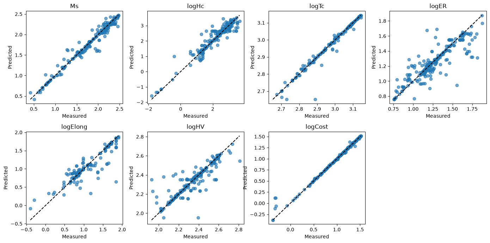
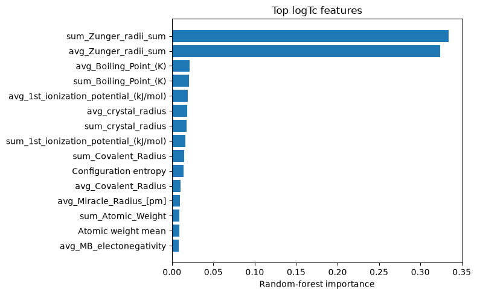

# Alloy Property Optimisation

## Problem

I wanted to see whether a model could learn from Fe–Ni–Co compositions, then search within sensible composition limits for promising magnetic-property trade-offs.

## Approach

I turned the composition columns into features, trained tree-based regressors, and used Bayesian optimisation over Fe, Co, and Ni. Before each prediction, I checked that all values were non-negative and added to 100 at.%.

## Skills

- Feature engineering for composition data
- Scikit-learn regression and held-out evaluation
- Constrained Bayesian optimisation with reproducible search bounds
- Model persistence and feature-order validation

## What I did

I built composition and alloy-specific features, trained one random-forest model per property, compared training and held-out results, then tuned the two magnetic-property models used by the composition search. I also checked every proposed Fe–Co–Ni mixture before prediction so the search could not suggest a negative percentage or a total other than 100 at.%.

## Result

The seven held-out property models gave R² values from **0.777** (`logER`) to **0.986** (`logCost`). The tuned `Ms` model reached test R² **0.969** with RMSE **0.088**; tuned `logTc` reached test R² **0.975** with RMSE **0.018**. The constrained search returned Fe 80.394 at.%, Co 19.571 at.%, and Ni 0.035 at.% for its chosen prediction target. This is a model output, not a material I made in a lab.

## Engineering judgement

A high R² is useful only if the inference path keeps the same feature order and the search cannot leave the feasible composition region. I kept constraint validation beside prediction, not as a separate manual check. The importance chart is a fitted-model diagnostic, not a causal materials claim.

## Evidence

Figure sources and exact output cells are listed in [evidence notes](../../docs/evidence.md). The constraint checks are in [composition_constraints.py](composition_constraints.py).

## Source and data

I used a local Fe–Ni–Co composition/property table. I am not sharing that file until I have confirmed its reuse terms. The public code will use a documented schema and an example input first.

## Public scope

This repository includes the figures, metric source map, and composition-constraint module. The local input table and full training/search notebook are not public, so this page is evidence for a reviewed result rather than a runnable training release.

## Limits

These are model estimates inside the composition ranges I gave the model, not new material discoveries. Results depend on the data, features, train/test split, and how I weight the objectives. I did not run laboratory validation.
