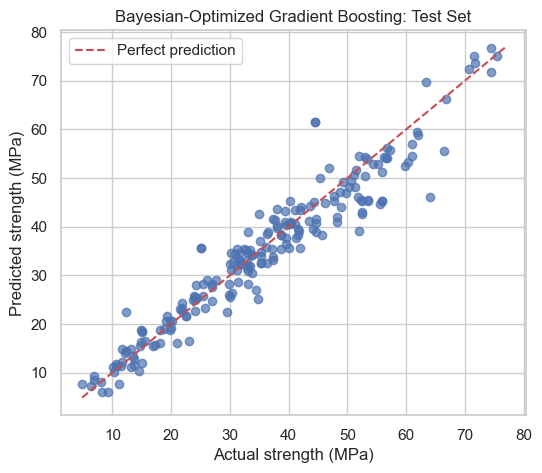
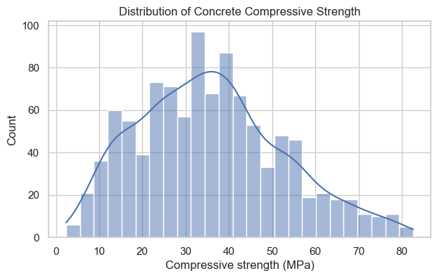

# Bayesian Optimisation for Strength

## Problem

I used Bayesian optimisation to tune a concrete-compressive-strength model without using the test set to guide the search.

## Approach

I prepared mix-design features, trained a few baseline regressors, then used a Gaussian-process search to tune gradient boosting. I compared acquisition choices and kernel settings instead of relying on one default search setup.

## Skills

- Tabular data preparation and exploratory analysis
- Scikit-learn model pipelines and regression metrics
- Gaussian-process surrogate modelling
- Expected-improvement and lower-confidence-bound acquisition strategies

## What I did

I started with a default Gaussian process, then compared RBF and Matérn kernels on the same held-out concrete data. After that I used Bayesian optimisation to search gradient-boosting settings with three-fold cross-validation rather than trying parameter combinations by hand.

## Result

The default Gaussian process did not generalise: its held-out R² was **-49.990**. That failure showed why the kernel and setup needed checking. The Matern 3/2 configuration was best of the three tested kernels, with test MSE **49.317** and test R² **0.809**. The Bayesian gradient-boosting search found a best three-fold CV MSE of **22.543** using 137 estimators, learning rate 0.150882, depth 5, minimum leaf size 10, and subsample 0.5.

## What I learned

I learned not to trust an almost-perfect training plot. The default GP looked good on its training data and failed badly on the test data. Comparing kernels and keeping a separate test split made that clear. Bayesian search then gave me a disciplined way to spend a limited tuning budget.

## Evidence

Figure sources and output-backed settings are listed in [evidence notes](../../docs/evidence.md). The held-out metric helper is in [evaluate_model.py](evaluate_model.py).

## Source and data

I used the UCI Concrete Compressive Strength data provided with my local files. Before sharing a data copy, I will confirm the source details and list the expected columns.

## Reproduce

Install the root dependencies, add the concrete data file described here, and run with the fixed split seed. Compare baseline and tuned models only on the held-out data.

## Limits

This model is not a structural-design recommendation. It works on historical data, and its results can move when the seed, search budget, available features, or split changes.
