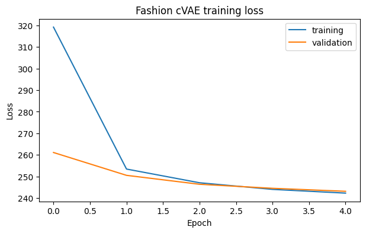
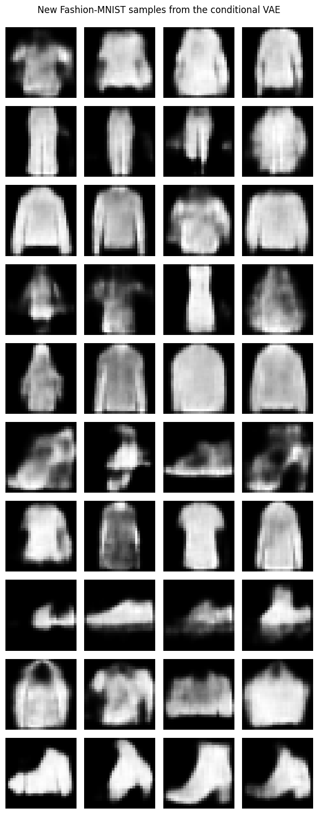
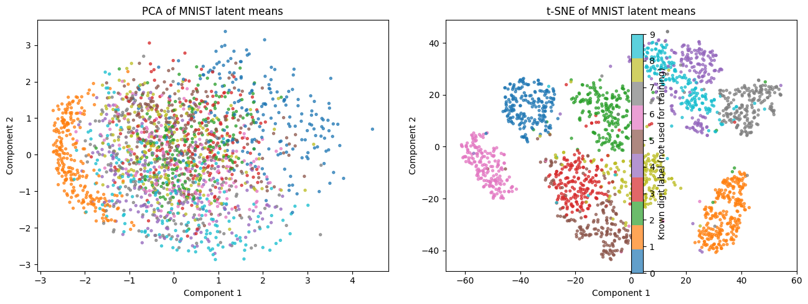

# Conditional Generative Design

## Problem

I trained a model to generate Fashion-MNIST-like images while controlling the class label, then looked at how the label changed the output.

## Approach

I normalised the images, encoded the labels, and trained a convolutional conditional VAE. I used PCA and t-SNE to look at the latent space, then decoded the same latent vectors with different labels to see the change.

## Skills

- TensorFlow/Keras modelling
- Convolutional encoder/decoder design
- Conditional variational autoencoders
- Latent-space visualisation with PCA and t-SNE

## What I did

I trained a conditional VAE on Fashion-MNIST for five epochs. The encoder received the image and one-hot class label; the decoder received a sampled latent point and the same label. I also trained an unlabelled MNIST VAE and used PCA and t-SNE to inspect how its latent means were arranged.

## Result

Fashion cVAE validation loss fell from **261.115** after the first epoch to **243.129** after the fifth. The generated grid is direct output from that short run. It shows recognisable class-shaped patterns, but also blur and uneven detail, so I treat it as evidence of a working learning pipeline rather than finished image generation.

## What I learned

I learned how conditioning changes a VAE: the same latent point can be decoded with different labels. I also learned that loss curves and sample grids answer different questions. Lower loss is useful, but generated images still need a visual check.

## Evidence

Figure sources and training outputs are listed in [evidence notes](../../docs/evidence.md). Input preparation is in [data_pipeline.py](data_pipeline.py).

## Source and data

I load Fashion-MNIST through Keras. I left out local caches and trained weights; the data can be downloaded through the loader.

## Reproduce

Create the Python environment, let Keras download Fashion-MNIST on the first run, set the seed, and train the smaller configuration. Save fresh image grids instead of relying on files from my machine.

## Limits

The generated images are for exploration, not finished designs. Quality changes with training time, model shape, seed, class balance, and hardware. A few good-looking grids do not prove the model generalises.
