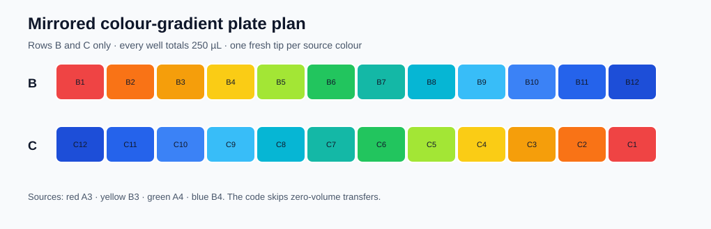

# Laboratory Automation Protocol

## Problem

I wrote a two-row colour-gradient protocol for a 96-well plate.

## Approach

Four source colours fill the first row with set volumes. The second row runs in reverse to create the mirror image. I use one tip per colour to reduce carryover, and every well receives 250 µL in total.

## Skills

- Python protocol development
- Opentrons API and deck-layout definition
- Volume accounting and plate-coordinate mapping
- Experimental automation documentation

## What I did

I defined explicit red, yellow, green, and blue volumes for twelve wells, then applied the same gradient in reverse on the second plate row. The code picks up one fresh tip for each source colour and dispenses only non-zero volumes.

## Result

The layout below is generated directly from the committed 250 µL volume matrix. Row B moves from red to blue. Row C mirrors it, so a person checking the plate can quickly see whether the planned pattern is right.

## Engineering judgement

The protocol is written to be reviewed before hardware moves. Deck slots, labware identifiers, starting tip, per-well totals, source order, and carryover controls are explicit because a loop that runs is not enough for a reliable robot run.

## Evidence

The diagram maps directly to `SOURCE_WELLS`, `GRADIENT_UL`, and `TOTAL_VOLUME_UL` in [rainbow_gradient.py](rainbow_gradient.py). It is a dispensing plan, not proof of a physical robot run.

## Source and data

I wrote the protocol against the Opentrons API using named standard labware. It does not include private results or hardware logs.

## Reproduce

Check the deck, labware, pipette, reservoir, and starting-tip settings in the protocol. Run the Opentrons simulator and complete local safety checks before using a robot.

## Limits

The code describes transfers; it does not prove that a robot run succeeded. Labware calibration, reagent compatibility, robot setup, tips, and lab approval still matter.
