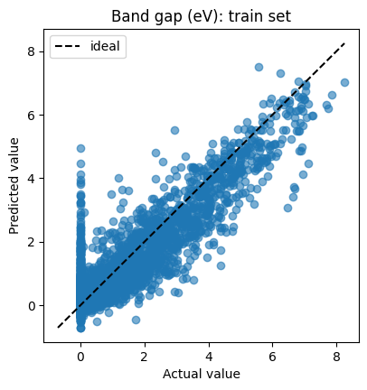
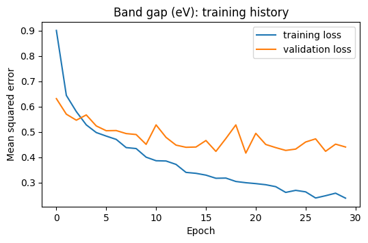
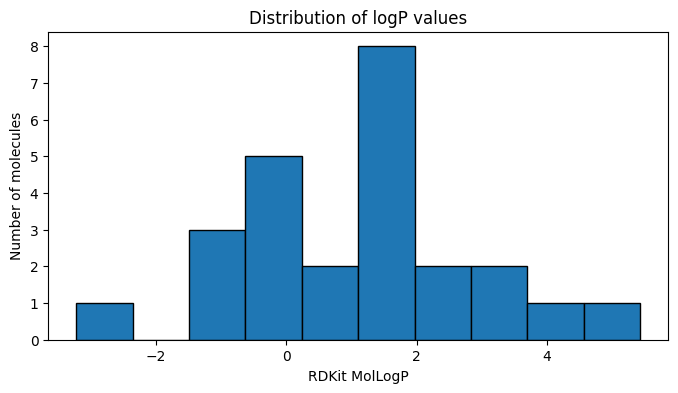

# Materials Informatics & Cheminformatics

## Problem

Use composition data to predict material properties, then use molecular descriptors to compare small molecules in a repeatable way.

## Approach

I queried ternary materials data in a local working environment, built composition-based features with CBFV, and trained small neural regressors for band gap, formation energy, and bulk modulus. Separately, I used RDKit to validate SMILES strings and calculate LogP values for a small molecule set.

## Skills

- Materials Project data workflow and local response caching
- Composition-based feature vectors with CBFV
- TensorFlow regression with train-only scaling
- RDKit SMILES parsing, molecular drawing, and LogP descriptors

## What I did

I prepared **5,731** training and **1,433** test material records after feature generation. I kept feature scaling inside the training path, plotted learning curves and measured-versus-predicted values, then checked 25 molecular SMILES strings before calculating their LogP values.

## Result

The band-gap model reached held-out R² **0.712** and the formation-energy model reached **0.924**. The bulk-modulus model did not generalise on this setup, with held-out R² **-0.001**. I kept that result because it shows where more work is needed. All **25** selected SMILES strings parsed successfully; calculated LogP values ranged from **-3.221** for glucose to **5.427** for cholesterol.

## What I learned

I learned that a shared feature pipeline does not guarantee equal performance across targets. Formation energy and band gap were useful fits here; bulk modulus was not. I also learned how to separate live API access from local analysis so an API key never needs to be in source control.

## Evidence

The public repository contains no API key or cached API response. Figure sources, output cells, and result boundaries are listed in [evidence notes](../../docs/evidence.md).

## Source and data

The original data query ran against the Materials Project API in a local environment. The raw response cache is excluded because it is large and is not needed to understand the public result figures.

## Reproduce

Use your own Materials Project API key through an untracked environment file, obtain data under the provider's terms, then run the same feature and model steps described above.

## Limits

These results are limited to the local data split and chosen descriptors. They are not a claim that a material has been experimentally validated or that the bulk-modulus model is ready to use.
